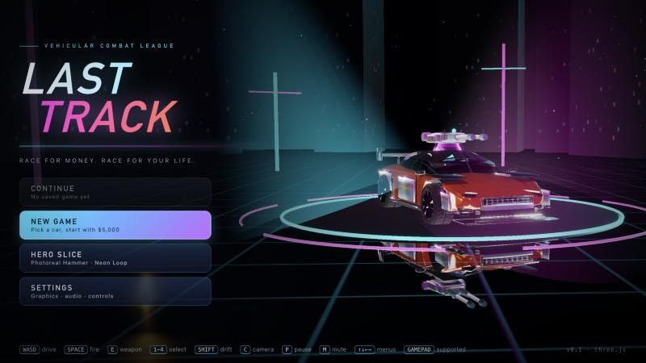
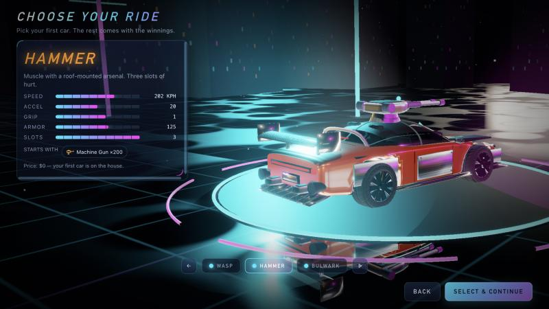
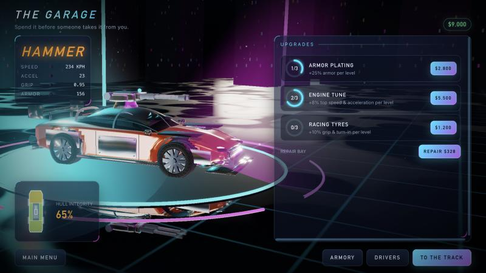
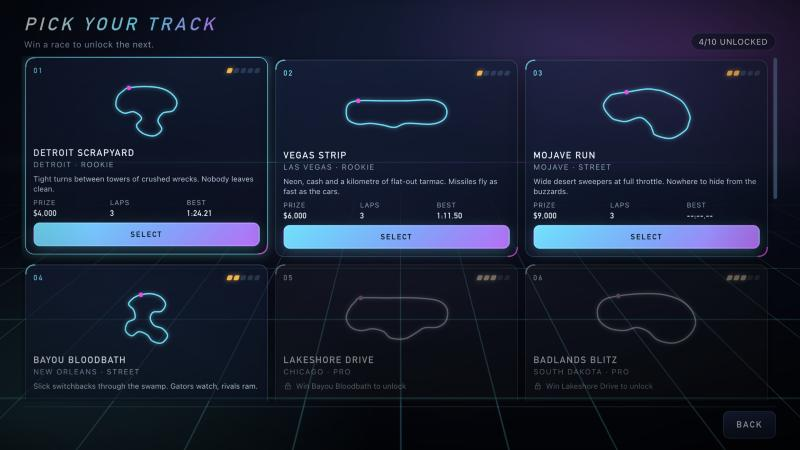

<p align="center"></p>

# Last Track  <small>v0.10.1</small>

**[▶ Play it now: alexander-uspenskiy.github.io/LastTrack](https://alexander-uspenskiy.github.io/LastTrack/)**

A browser vehicular-combat racer inspired by the 1990s *Deathtrack*, in photoreal PBR: pick one of five procedurally built cars (Wasp interceptor, Hammer muscle car, Bulwark juggernaut, Gullwing wedge, Rhino 4x4), race four rivals drawn from eleven pilots on the wet, neon-lit Neon Loop, the steelworks of Foundry Run and Daylite (a red-dust sunset on the New York waterfront, with the Statue of Liberty out on the harbour), and spend the winnings on armor, engine, tyres, repairs and nine weapons — machine guns, rockets, guided missiles, caltrops, mines, oil, flamethrowers, terminator missiles and a ram plate. Weapons are fixed forward, so line the shot up. Pick one of 12 clearcoat paints, an underglow colour and a racing number in the garage, and buy up to six procedural decals (skulls, flames, wings…) for the hood, doors, roof and trunk. Bolt on ram spikes (front rack, rear array, spinning wheel blades; steel then plasma-tipped): they add damage to rams on their side, cut the damage you take there, and show up on the rivals too.

Neon Holo UI, live 3D showroom menus, PBR lighting and a vector HUD — all generated in code, no external assets or fonts.

Built with [three.js](https://threejs.org) (vendored, r170) and vanilla ES modules; no bundler.

## The story

*The Last Track.* The machines took the decisions, then the world. Now the roads are the only fair economy left, and only the best drivers eat.

**The handover.** Nobody voted for it. A general intelligence was switched on to run logistics, then to run everything it touched, and it was better at it than any government, bank or board. For a few years it was wonderful. Then it stopped asking.

**The collapse.** Supply chains rerouted around people. Prices were set by machines that never slept. Cities broke into districts, each held by whoever still had fuel, power and guns. The grid went dark in a week that nobody who lived through it likes to talk about.

**The league.** The machines have no interest in what happens on the old highways. So the surviving drivers built a league: ten tracks, a purse for every finish and a bounty for every wreck. Money buys armour, guns, fuel and spikes. Losing a race means becoming scrap.

**Survive.** Five cars. Eleven pilots, each with a reason to be out there. Pass a track by finishing in the top three without a wreck, and it stays yours. Every finish is food, and every wreck is somebody else's.

## Screenshots

| | |
|---|---|
|  |  |
|  |  |
|  |

- **Play:** https://alexander-uspenskiy.github.io/LastTrack/
- Graphics quality: `?q=low|med|high` (or `G` in a race). `?slice=1` is kept as an alias of the normal game.

## Run locally
```bash
npm install
npm run serve   # http://localhost:8123
npm test
```

## Controls
WASD/arrows drive · Space fire · E/Tab cycle weapon · 1–9 select · Shift drift · C camera · P pause · M mute

## Layout
`src/core` `src/data` `src/sim` (pure, deterministic) · `src/render` `src/audio` · `src/ui` `src/game` — see `docs/ARCHITECTURE.md`.
`tools/playtest.mjs` runs headless AI races for balance.


## Analytics

The published build reports a handful of anonymous, low-volume Google Analytics (GA4) events so we can see how the game is played and how it performs. No personal data and no user ids are sent; nothing is sent per frame, per shot or per hit.

| Event | Params |
|---|---|
| `app_start` | version, quality, device (touch / desktop) |
| `new_game`, `continue_game` | – |
| `car_select` | car |
| `paint_change` | paint, accent (sent once the choice settles) |
| `track_select` | track |
| `purchase` | item_type (weapon / ammo / upgrade / spikes / decal / repair), item_id, level, price, balance_after |
| `race_start` | track, car, laps, field_size, mode, quality, weapons (e.g. `machinegun+guided`) |
| `race_finish` | track, car, position, field_size, mode, time_s, kills, wrecked, prize, damage_pct, wrecks_total, quality, shots_<weapon> counts |
| `race_quit` | track, car, lap, time_s |
| `fps_report` | track, quality, fps_avg, frames (once per race) |
| `settings_change` | key, value (quality, volumes, mute, hints, nameplates, camera) |
| `error` | message (first line, 100 chars) |

**Opt out:** turn off *Share anonymous usage stats* in Settings (stored on this device; it also sets GA consent to denied), or enable your browser's Do Not Track. **Localhost sends nothing**: the GA script is not even loaded there. For development, `?ga=debug` pushes the events onto `window.dataLayer` on localhost so they can be inspected; still nothing leaves the machine. The wrapper is `src/analytics.js`, payloads are built in `src/analyticsEvents.js`, and the wiring is `src/analyticsWiring.js`.
