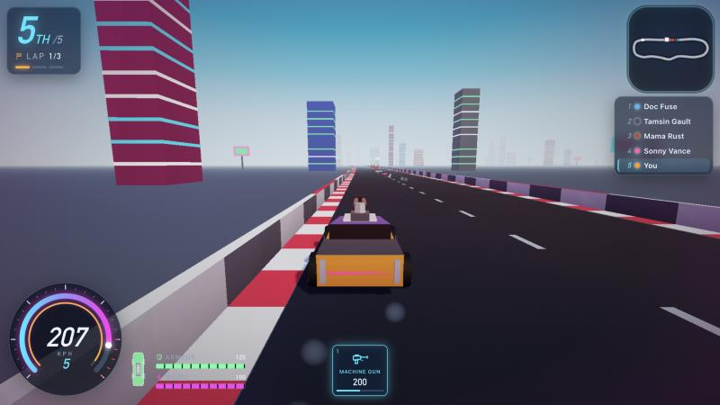

<p align="center"></p>

# Last Track  <small>v0.4.3</small>

**[▶ Play it now: alexander-uspenskiy.github.io/lastrack](https://alexander-uspenskiy.github.io/lastrack/)**

A browser vehicular-combat racer inspired by the 1990s *Deathtrack*, in photoreal PBR: pick one of three procedurally built cars (Wasp interceptor, Hammer muscle car, Bulwark juggernaut), race five rivals drawn from eight drivers on the wet, neon-lit Neon Loop and Foundry Run, and spend the winnings on armor, engine, tyres, repairs and eight weapons — machine guns, rockets, caltrops, mines, oil, flamethrowers, terminator missiles and a ram plate. Weapons are fixed forward, so line the shot up. Pick one of 12 clearcoat paints, an underglow colour and a racing number in the garage, and buy up to six procedural decals (skulls, flames, wings…) for the hood, doors, roof and trunk. Bolt on ram spikes (front rack, rear array, spinning wheel blades; steel then plasma-tipped): they add damage to rams on their side, cut the damage you take there, and show up on the rivals too.

Neon Holo UI, live 3D showroom menus, PBR lighting and a vector HUD — all generated in code, no external assets or fonts.

Built with [three.js](https://threejs.org) (vendored, r170) and vanilla ES modules; no bundler.

## Screenshots

| | |
|---|---|
|  |  |
|  |  |
|  | |

- **Play:** https://alexander-uspenskiy.github.io/lastrack/
- Graphics quality: `?q=low|med|high` (or `G` in a race). `?slice=1` is kept as an alias of the normal game.

## Run locally
```bash
npm install
npm run serve   # http://localhost:8123
npm test
```

## Controls
WASD/arrows drive · Space fire · E/Tab cycle weapon · 1–9 select · Shift handbrake · C camera · P pause · M mute

## Layout
`src/core` `src/data` `src/sim` (pure, deterministic) · `src/render` `src/audio` · `src/ui` `src/game` — see `docs/ARCHITECTURE.md`.
`tools/playtest.mjs` runs headless AI races for balance.
